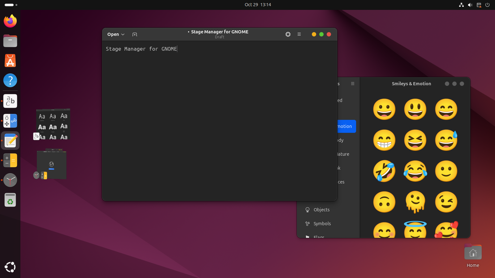

# Stage Manager for GNOME

A GNOME Shell extension that brings macOS-style **Stage Manager** to the Linux desktop.
The window group you are working with stays in the middle of the screen. Every other group is parked as a live thumbnail in a strip on the left edge, one click away.



*Text Editor and Characters share the stage. Fonts and a Clocks + Calculator group are parked on the left.*

## Features

- **One stage at a time.** Focusing a window by any means (click, Alt+Tab, the dock, the overview) puts its group on stage and parks the rest. Parked windows fly into the strip.
- **Per-window groups, like macOS.** Groups are made of windows, not apps, so two windows of the same app can be in different groups.
- **Drag and drop grouping.**
  - Drag a thumbnail onto the stage to add its windows to the current group.
  - Drag a window onto the strip to take just that window out.
- **Out of the way.** The strip hides while a window covers it or comes close to it. Touch the left screen edge with the pointer to bring it back.
- **Room for new windows.** Newly opened windows are placed beside the strip instead of under it. Windows you moved yourself are never moved.
- **Optional previews.** Turn the strip off and keep only the window parking, from Quick Settings or the extension settings.
- **Works with stubborn windows.** Some windows refuse to be minimized, such as the Android Emulator, which removes the minimize function through `_MOTIF_WM_HINTS`. These are hidden instead, together with their tool windows (like the emulator's side toolbar), so they don't show up on every stage.
- Turning Stage Manager off brings every parked window back.

## Usage

| Action | How |
| --- | --- |
| Bring a group on stage | Click its thumbnail, or focus any of its windows (Alt+Tab, dock, overview) |
| Add a group to the current stage | Drag its thumbnail onto the stage, or **Shift+click** / **Ctrl+click** it |
| Take one window out of the stage | Drag the window onto the strip (Super+drag also works) |
| Split a group into single windows | **Middle-click** its thumbnail |
| Show the strip while it is hidden | Push the pointer against the left screen edge |
| Turn Stage Manager on/off | **Super+Ctrl+S**, or the *Stage Manager* toggle in Quick Settings |
| Show/hide the previews | Quick Settings → arrow next to *Stage Manager* → *Show previews* |

A window you opened from the app that is on stage (for example with Ctrl+N) joins the stage. A window from any other app starts a group of its own. When Stage Manager is first turned on, the windows of each app start out in one group, like the "All at Once" default on macOS.

## Requirements

- GNOME Shell **46** (tested on Ubuntu 24.04 LTS, Wayland session)
- `git` and the `gnome-extensions` tool, which ships with GNOME Shell

## Installation

```bash
git clone https://github.com/thanhnguyen293/stage-manager.git
cd stage-manager
gnome-extensions pack --force \
  --extra-source=stageManager.js \
  --extra-source=sidebar.js \
  --extra-source=prefs.js
gnome-extensions install --force stage-manager@local.shell-extension.zip
```

GNOME Shell only picks up newly installed extensions when it starts.

- **Wayland** (the default on Ubuntu): log out and log back in.
- **X11**: press Alt+F2, type `r`, and press Enter.

Then enable the extension:

```bash
gnome-extensions enable stage-manager@local
```

You can also enable it from the **Extensions** app or **Extension Manager**.

### Updating

```bash
cd stage-manager
git pull
gnome-extensions pack --force --extra-source=stageManager.js --extra-source=sidebar.js --extra-source=prefs.js
gnome-extensions install --force stage-manager@local.shell-extension.zip
```

Then log out and back in to load the new version.

### Uninstalling

```bash
gnome-extensions uninstall stage-manager@local
```

## Settings

Open the settings window from the **Extensions** app, or run:

```bash
gnome-extensions prefs stage-manager@local
```

To change the on/off shortcut, which defaults to Super+Ctrl+S:

```bash
gsettings --schemadir ~/.local/share/gnome-shell/extensions/stage-manager@local/schemas \
  set org.gnome.shell.extensions.stage-manager toggle-shortcut "['<Super><Alt>m']"
```

## Limitations

- Only windows on the primary monitor are managed. Windows on other monitors, windows shown on all workspaces, and always-on-top windows such as picture-in-picture are left alone.
- Groups are kept in memory. After logging out, or turning Stage Manager off and on again, windows are grouped by app again.
- Thumbnails come from the windows' last drawn frame. Many apps stop redrawing while minimized, so a thumbnail may not update live.

## Project layout

| File | Purpose |
| --- | --- |
| `extension.js` | Entry point: Quick Settings toggle and keyboard shortcut |
| `stageManager.js` | Stage logic: which windows are on stage, grouping, parking |
| `sidebar.js` | The strip of thumbnails, drag and drop, auto-hide |
| `prefs.js` | Settings window |
| `schemas/` | GSettings schema (`enabled`, `show-previews`, `toggle-shortcut`) |

## License

Stage Manager for GNOME is free software, licensed under the
[GNU General Public License v2.0 or later](LICENSE) (`GPL-2.0-or-later`),
the same license as GNOME Shell.

## Tiếng Việt

**Stage Manager cho GNOME** là extension đưa tính năng Stage Manager của macOS lên Ubuntu/GNOME. Nhóm cửa sổ đang dùng nằm giữa màn hình, các nhóm khác được thu gọn thành thumbnail ở cạnh trái.

**Cài đặt:**

```bash
git clone https://github.com/thanhnguyen293/stage-manager.git
cd stage-manager
gnome-extensions pack --force --extra-source=stageManager.js --extra-source=sidebar.js --extra-source=prefs.js
gnome-extensions install --force stage-manager@local.shell-extension.zip
```

Đăng xuất rồi đăng nhập lại (bắt buộc trên Wayland), sau đó chạy:

```bash
gnome-extensions enable stage-manager@local
```

**Cách dùng nhanh:**

- **Đưa một nhóm lên giữa màn hình:** click thumbnail, hoặc chuyển sang cửa sổ đó bằng Alt+Tab, dock hay Overview.
- **Gộp vào nhóm đang hiện:** kéo thumbnail thả vào giữa màn hình, hoặc Shift/Ctrl+click.
- **Tách một cửa sổ ra khỏi nhóm:** kéo cửa sổ đó thả vào dải bên trái.
- **Tách cả nhóm thành từng cửa sổ:** click chuột giữa vào thumbnail.
- **Khi dải đang ẩn:** đưa chuột sát cạnh trái màn hình để dải hiện ra.
- **Bật/tắt Stage Manager:** Super+Ctrl+S, hoặc nút trong Quick Settings.
- **Bật/tắt preview:** mở mũi tên cạnh nút Stage Manager trong Quick Settings.

**Giấy phép:** GPL-2.0-or-later, xem file [LICENSE](LICENSE).
