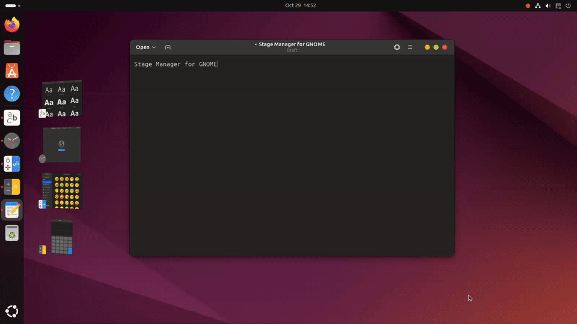
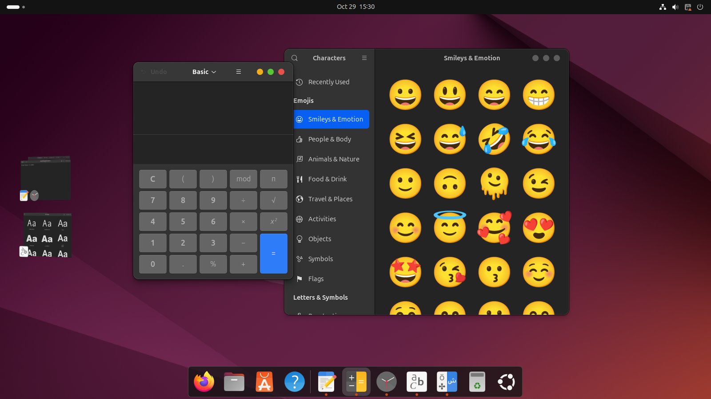

# Stage Manager cho GNOME

[English](README.md) | **Tiếng Việt**

[](https://www.gnome.org/)
[](LICENSE)
[](https://github.com/thanhnguyen293/stage-manager/stargazers)
[](https://github.com/thanhnguyen293/stage-manager/forks)
[](https://github.com/thanhnguyen293/stage-manager/issues)
[](https://github.com/thanhnguyen293/stage-manager/commits/main)
[](https://hits.sh/github.com/thanhnguyen293/stage-manager/)

Extension cho GNOME Shell, mang tính năng **Stage Manager** của macOS lên desktop Linux.
Nhóm cửa sổ bạn đang làm việc nằm giữa màn hình. Các nhóm khác được thu gọn thành thumbnail trực tiếp trong một dải ở cạnh trái, chỉ cần một cú click để gọi lại.



*Click thumbnail để chuyển sân khấu, kéo một thumbnail vào sân khấu để gom nhóm, và Alt+Tab gọi lại cả nhóm.*

## Tính năng

- **Mỗi lúc một sân khấu.** Khi bạn chuyển sang một cửa sổ bằng bất kỳ cách nào (click, Alt+Tab, dock, Overview), nhóm của cửa sổ đó lên sân khấu và các nhóm còn lại được cất đi. Cửa sổ bị cất bay vào dải bên trái.
- **Nhóm theo từng cửa sổ, giống macOS.** Nhóm gồm các cửa sổ chứ không phải app, nên hai cửa sổ của cùng một app có thể nằm ở hai nhóm khác nhau.
- **Gom nhóm bằng kéo-thả.**
  - Kéo thumbnail thả vào sân khấu để thêm các cửa sổ của nó vào nhóm đang hiện.
  - Kéo một cửa sổ thả vào thumbnail của stage khác để chuyển nó sang đó, hoặc thả vào chỗ trống trên dải để nó thành một stage riêng. Dải hiện ra trong lúc kéo, kể cả khi đã tắt preview.
- **Không vướng víu.** Dải tự ẩn khi có cửa sổ đè lên hoặc nằm sát nó. Đưa chuột chạm cạnh trái màn hình để dải hiện lại.
- **Chừa chỗ cho cửa sổ mới.** Cửa sổ vừa mở được đặt cạnh dải thay vì nằm đè lên. Cửa sổ bạn tự kéo đi đâu thì nằm yên ở đó.
- **Ẩn icon desktop (tùy chọn).** Ẩn các icon trên desktop khi có cửa sổ trên sân khấu, giống macOS. Icon hiện lại khi sân khấu trống.
- **Có thể tắt preview.** Tắt dải thumbnail, chỉ giữ lại việc cất cửa sổ theo nhóm, ngay trong Quick Settings hoặc trang cài đặt của extension.
- **Xử lý được cửa sổ "cứng đầu".** Một số cửa sổ không cho thu nhỏ, ví dụ Android Emulator (nó bỏ chức năng thu nhỏ qua `_MOTIF_WM_HINTS`). Những cửa sổ này được ẩn đi thay vì thu nhỏ, kèm theo các cửa sổ công cụ của chúng (như thanh công cụ bên cạnh emulator), nên không còn hiện ở mọi stage.
- Tắt Stage Manager thì mọi cửa sổ đang bị cất sẽ hiện lại.

## Cách dùng

| Thao tác | Cách làm |
| --- | --- |
| Đưa một nhóm lên sân khấu | Click thumbnail của nó, hoặc chuyển sang một cửa sổ bất kỳ trong nhóm (Alt+Tab, dock, Overview) |
| Thêm một nhóm vào sân khấu hiện tại | Kéo thumbnail thả vào sân khấu, hoặc **Shift+click** / **Ctrl+click** vào nó |
| Chuyển một cửa sổ sang stage khác | Kéo cửa sổ thả vào thumbnail của stage đó (Super+kéo cũng được) |
| Tách một cửa sổ thành stage riêng | Kéo cửa sổ thả vào chỗ trống trên dải |
| Chuyển stage trong lúc đang kéo | Khi đang kéo cửa sổ, giữ chuột trên một thumbnail một lúc, hoặc **gõ phím Alt** để lần lượt chuyển qua các stage. Thả cửa sổ ở bất kỳ đâu để nó ở lại stage đang hiện. |
| Tách một nhóm thành từng cửa sổ | **Click chuột giữa** vào thumbnail |
| Hiện dải khi đang bị ẩn | Đưa chuột chạm cạnh trái màn hình |
| Bật/tắt Stage Manager | **Super+Ctrl+S**, hoặc nút *Stage Manager* trong Quick Settings |
| Bật/tắt preview | Quick Settings → mũi tên cạnh *Stage Manager* → *Show previews* |
| Ẩn icon desktop khi có cửa sổ trên sân khấu | Quick Settings → mũi tên cạnh *Stage Manager* → *Hide desktop icons* |

Cửa sổ mở từ app đang ở trên sân khấu (ví dụ bấm Ctrl+N) sẽ vào luôn sân khấu. Cửa sổ của app khác tự tạo nhóm riêng. Lúc mới bật Stage Manager, các cửa sổ của cùng một app được gom chung một nhóm, giống chế độ mặc định "All at Once" của macOS.



## Yêu cầu

- GNOME Shell **46** (đã thử trên Ubuntu 24.04 LTS, phiên Wayland)
- `git` và công cụ `gnome-extensions` (có sẵn cùng GNOME Shell)

## Cài đặt

### Từ bản phát hành (dễ nhất)

Tải file `stage-manager@local.shell-extension.zip` ở [bản phát hành mới nhất](https://github.com/thanhnguyen293/stage-manager/releases/latest), rồi chạy:

```bash
gnome-extensions install --force stage-manager@local.shell-extension.zip
```

### Từ mã nguồn

```bash
git clone https://github.com/thanhnguyen293/stage-manager.git
cd stage-manager
gnome-extensions pack --force \
  --extra-source=stageManager.js \
  --extra-source=sidebar.js \
  --extra-source=prefs.js
gnome-extensions install --force stage-manager@local.shell-extension.zip
```

GNOME Shell chỉ nhận extension mới cài khi khởi động.

- **Wayland** (mặc định trên Ubuntu): đăng xuất rồi đăng nhập lại.
- **X11**: bấm Alt+F2, gõ `r` rồi Enter.

Sau đó bật extension:

```bash
gnome-extensions enable stage-manager@local
```

Bạn cũng có thể bật trong app **Extensions** hoặc **Extension Manager**.

### Cập nhật

Cài file zip của bản phát hành mới nhất theo cách trên, hoặc nếu dùng mã nguồn:

```bash
cd stage-manager
git pull
gnome-extensions pack --force --extra-source=stageManager.js --extra-source=sidebar.js --extra-source=prefs.js
gnome-extensions install --force stage-manager@local.shell-extension.zip
```

Sau đó đăng xuất rồi đăng nhập lại để chạy bản mới.

### Gỡ cài đặt

```bash
gnome-extensions uninstall stage-manager@local
```

## Cài đặt tùy chọn

Mở cửa sổ cài đặt trong app **Extensions**, hoặc chạy:

```bash
gnome-extensions prefs stage-manager@local
```

Đổi phím tắt bật/tắt (mặc định Super+Ctrl+S):

```bash
gsettings --schemadir ~/.local/share/gnome-shell/extensions/stage-manager@local/schemas \
  set org.gnome.shell.extensions.stage-manager toggle-shortcut "['<Super><Alt>m']"
```

## Giới hạn

- Chỉ quản lý cửa sổ trên màn hình chính. Cửa sổ ở màn hình khác, cửa sổ ghim trên mọi workspace và cửa sổ luôn ở trên cùng (như picture-in-picture) được giữ nguyên.
- Thông tin nhóm chỉ lưu trong bộ nhớ. Sau khi đăng xuất, hoặc tắt rồi bật lại Stage Manager, các cửa sổ được gom lại theo app.
- Không dùng được Alt+Tab trong lúc đang kéo cửa sổ, vì Mutter bỏ qua mọi phím tắt khi đang kéo. Thay vào đó chỉ cần gõ riêng phím Alt (xem mục Cách dùng).
- Thumbnail lấy từ khung hình cuối cùng của cửa sổ. Nhiều app ngừng vẽ khi bị thu nhỏ, nên thumbnail có thể không cập nhật liên tục.

## Cấu trúc dự án

| File | Vai trò |
| --- | --- |
| `extension.js` | Điểm khởi chạy: nút trong Quick Settings và phím tắt |
| `stageManager.js` | Logic sân khấu: cửa sổ nào đang hiện, gom nhóm, cất cửa sổ |
| `sidebar.js` | Dải thumbnail, kéo-thả, tự ẩn |
| `prefs.js` | Cửa sổ cài đặt |
| `schemas/` | GSettings schema (`enabled`, `show-previews`, `hide-desktop-icons`, `toggle-shortcut`) |
| `media/` | GIF demo và ảnh chụp dùng trong README |

## Lộ trình

| Tính năng | Trạng thái |
| --- | --- |
| Cất cửa sổ vào dải thumbnail trực tiếp | ✅ |
| Nhóm theo từng cửa sổ, gom nhóm bằng kéo-thả | ✅ |
| Chuyển cửa sổ sang stage khác bằng cách thả vào thumbnail, kể cả khi tắt preview | ✅ |
| Chuyển stage trong lúc kéo cửa sổ (giữ chuột trên thumbnail, hoặc gõ Alt) | ✅ |
| Cả nhóm hiện lại khi dùng Alt+Tab, dock hoặc Overview | ✅ |
| Hiệu ứng thu nhỏ bay vào dải | ✅ |
| Dải tự ẩn khi có cửa sổ gần, hiện khi chạm cạnh màn hình | ✅ |
| Sân khấu riêng cho mỗi workspace | ✅ |
| Trả lại mọi cửa sổ khi tắt | ✅ |
| Cửa sổ không cho thu nhỏ (Android Emulator và thanh công cụ của nó) | ✅ |
| Ẩn icon desktop khi có cửa sổ trên sân khấu | ✅ |
| Nút trong Quick Settings, phím tắt và cửa sổ cài đặt | ✅ |
| Hỗ trợ nhiều màn hình | ⬜ |
| Ghi nhớ nhóm qua các lần đăng nhập | ⬜ |
| GNOME Shell 47 trở lên | ⬜ |
| Dịch các chuỗi trong cài đặt và menu | ⬜ |
| Đăng lên extensions.gnome.org | ⬜ |

## Đóng góp

Mọi báo lỗi, ý tưởng và pull request đều được hoan nghênh. Xem [CONTRIBUTING.vi.md](CONTRIBUTING.vi.md) để biết cách báo lỗi, chuẩn bị môi trường phát triển và mở pull request. Mọi người tham gia cần tuân theo [Quy tắc ứng xử](CODE_OF_CONDUCT.md) (bản tiếng Anh).

## Giấy phép

Stage Manager cho GNOME là phần mềm tự do, phát hành theo giấy phép
[GNU General Public License v2.0 hoặc mới hơn](LICENSE) (`GPL-2.0-or-later`),
cùng giấy phép với GNOME Shell.
